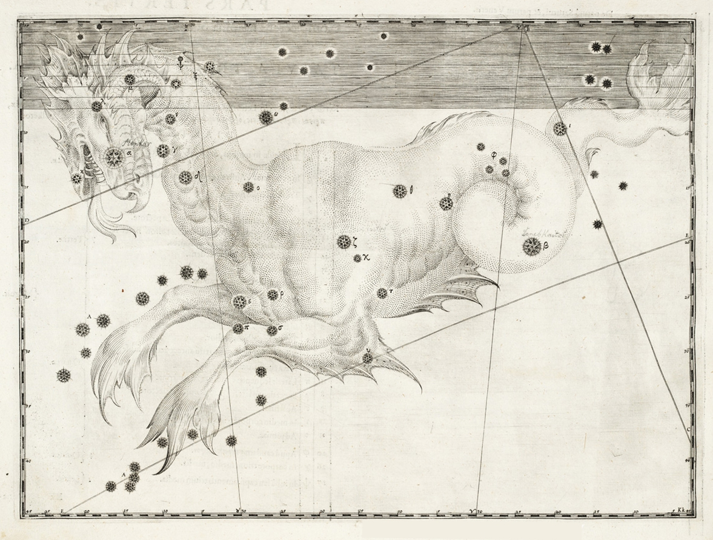

# Multilingual Primary Source Records on Omicron Ceti (Mira)

Because **Omicron Ceti ($\omicron$ Ceti)** swings between magnitude **~2.0** (a bright naked-eye star) and **~10.1** (completely invisible without a telescope) every **~332 days**, pre-telescopic astronomers across East Asia, the Islamic Golden Age, and early modern Europe encountered it in distinct ways: imperial court astronomers logged sudden appearances as *"guest stars"* (`客星`), medieval Islamic star catalogers noted its absence or faintness while revising Ptolemy's *Qīṭus* (`قيطس`), and European observers finally tracked its periodic disappearance and return.

---

## 1. East Asian Imperial Chronicles (Classical Chinese `漢文` & Korean `한문`)

In traditional Chinese uranography (star mapping), Omicron Ceti lies immediately adjacent to the asterism **`Tiānjūn` (`天囷`, Celestial Granary)**—a circular ring of 13 stars in Cetus ($\alpha, \gamma, \delta, \lambda, \mu, \nu, \xi$ Ceti)—and north of **`Tiāncāng` (`天倉`, Square Celestial Granary)**.

### A. 1070 CE (December 25) — *Sòng Shǐ* (`宋史`, *History of Song*) & *Goryeosa* (`高麗史`, *History of Goryeo*)
* **Original Classical Chinese Entry (*Sòng Shǐ*, Treatise on Astronomy / `天文志`, juan 56):**
  > 「熙寧三年十一月丁未，客星出天囷。」
  > *(Pinyin: Xīníng sān nián shíyī yuè dīngwèi, kèxīng chū Tiānjūn.)*
* **English Translation:**
  > *"In the 3rd year of the Xīníng reign [1070 CE], 11th month, day dīngwèi [December 25, 1070], a guest star (`客星`, kèxīng) appeared at Tiānjūn [the Celestial Granary, Cetus]."*
* **Historical & Archival Analysis:** Recorded independently by both Northern Song court astronomers in Kaifeng (*Sòng Shǐ*) and Korean royal astronomers (*Goryeosa*), this transient appeared precisely inside the Cetus asterism bordering $\omicron$ Ceti. Modern historical-astronomy catalogs (Ho Peng Yoke 1962, *Vistas in Astronomy* 5, 127; Stephenson & Green 2002, *Historical Supernovae and Their Remnants*; Wilk 1996, *JAAVSO* 24, 129) evaluate the 1070 CE *Tiānjūn* guest star as a prime candidate for a bright maximum of Mira (or a classical nova in Cetus).
* **Primary Digitized Archive:** [Chinese Text Project (`ctext.org`) — *Sòng Shǐ* (`宋史`)](https://ctext.org/wiki.pl?if=en&res=468831)

### B. 1596 CE — *Chosŏn Wangjo Sillok* (`朝鮮王朝實錄`, *Veritable Records of the Joseon Dynasty*)
* **Context:** During the 29th year of King Seonjo (`宣祖二十九年`, 1596 CE), court observers of the Korean *Gwansanggam* (`觀象監`, Royal Bureau of Astronomy) recorded a transient guest star (`客星`) in the Cetus/*Tiānjūn* sector during the same 1596 observing season that David Fabricius tracked $\omicron$ Ceti in East Frisia.
* **Primary Digitized Archive:** [National Institute of Korean History — *Veritable Records of the Joseon Dynasty* (`朝鮮王朝實錄`)](https://sillok.history.go.kr/)

### C. 5 BCE (Spring) — *Hàn Shū* (`漢書`, *Book of Han*, *Tiānwén Zhì* `天文志`)
* **Original Classical Chinese Entry:**
  > 「建平二年二月，彗星出牽牛七十餘日。」
  > *(Parallel entry in the Annals of Emperor Ai / `哀帝紀` notes a broom/guest star visible for over 70 days.)*
* **English Translation:**
  > *"In the 2nd year of the Jiànpíng reign [5 BCE], 2nd month, a broom/guest star appeared at Qiānniú [Ox lunar mansion] for more than 70 days."*
* **Cross-Reference:** Examined in [[archeoastronomy/star-of-bethlehem-hypothesis|Star of Bethlehem Hypothesis]] alongside East Asian nova/comet identifications (Stephenson & Green 2009).

---

## 2. Middle Eastern Arabic (`العربية`) & Persian (`فارسی`) Astronomical Manuscripts

### A. ʿAbd al-Raḥmān al-Ṣūfī (964 CE, Shiraz) — *Kitāb Ṣuwar al-Kawākib al-Thābita* (`كتاب صور الكواكب الثابتة`)
* **Author & Date:** Written in Arabic around **964 CE** in Shiraz (Buyid Persia) by Persian astronomer **ʿAbd al-Raḥmān ibn ʿUmar al-Ṣūfī** (`عبد الرحمن الصوفي`, Latinized as *Azophi*) for Buyid emir ʿAḍud al-Dawla.
* **Chapter on Cetus (`قيطس`, *Qīṭus*):** Al-Ṣūfī systematically re-observed all 48 Ptolemaic constellations by naked eye, criticizing Ptolemy where *Almagest* magnitudes or positions disagreed with the real sky, and preserving pre-Islamic **indigenous Bedouin Arab star lore** alongside Greek constellation figures. In *Qīṭus* (`قيطس`), al-Ṣūfī mapped the Arab asterisms **`al-Kaff al-Jadhmāʾ` (`الكف الجذماء`, the Mutilated Hand)** in the head of Cetus and **`al-Naʿāmāt` (`النعامات`, the Ostriches)** across the torso/tail.
* **Significance for Mira:** Because al-Ṣūfī personally verified every visible star down to 5th–6th magnitude in *Qīṭus* around 964 CE—and recorded no bright 2nd–3rd magnitude star at $\omicron$ Ceti's coordinates—his survey provides a rigorously dated medieval negative observation consistent with $\omicron$ Ceti sitting in its prolonged faint phase during his observing window.
* **Surviving Manuscripts & Primary Editions:**
  * **Oldest Surviving Complete Arabic Manuscript:** Doha Museum of Islamic Art **MS 2.1998** (Baghdad, 1125 CE).
  * **Bodleian Library Manuscript:** Oxford Bodleian **MS Marsh 144** (dated 400 AH / 1009–1010 CE).
  * **French/Arabic Critical Edition:** Schjellerup, H. C. F. C. (1874), *Description des étoiles fixes par Abd-al-Rahman al-Sûfi* (St. Petersburg) — [Wikipedia / Edition Bibliography](https://en.wikipedia.org/wiki/The_Book_of_Fixed_Stars)
  * **Modern English Study & Translation:** Hafez, Ihsan (2010), *Abd al-Rahman al-Sufi and his Book of the Fixed Stars: A Journey of Re-Discovery* (James Cook University) & [Al-Sufi's Investigation of Stars, Star Clusters and Nebulae (ResearchGate PDF)](https://www.researchgate.net/publication/253018854_Al-Sufi's_Investigation_of_Stars_Star_Clusters_and_Nebulae).

### B. Naṣīr al-Dīn al-Ṭūsī (13th c.) & Ulugh Beg (1437 CE, Samarkand)
* **Persian Translation:** Polymath **Naṣīr al-Dīn al-Ṭūsī** (`نصیرالدین طوسی`) translated al-Ṣūfī's treatise into Persian as *Tarjama-i Kitāb-i Ṣuwar al-Kawākib* (`ترجمه كتاب صور الكواكب`; autograph manuscript **Süleymaniye MS Ayasofya 2595**, preserved in Ulugh Beg's royal library in Samarkand).
* **Timurid Re-Observation (*Zīj-i Sulṭānī*, 1437 CE):** At the Samarkand Observatory, **Ulugh Beg** (`الغ بیگ`) and his astronomers re-measured the ecliptic coordinates of *Qīṭus* independently from scratch, likewise logging the Ptolemaic framework without a permanent bright star at $\omicron$ Ceti.

---

## 3. European Latin & Early Modern Primary Print Sources

### A. David Fabricius (1596 & 1609) — First Documented European Naked-Eye Tracking
* **Date & Location:** **August 3, 1596 (Julian) / August 13, 1596 (Gregorian)**, Resterhafe, East Frisia (northern Germany).
* **Observation:** Lutheran pastor and astronomer **David Fabricius** observed an uncataloged 3rd-magnitude star in Cetus while measuring the position of Mercury/Jupiter. By August 21 it brightened to **2nd magnitude**, then steadily faded until it vanished from naked-eye view in October 1596. Assuming it was a *stella nova* (like Tycho's 1572 supernova), Fabricius was astonished when he spotted the exact same star shining brightly again on **February 15, 1609**.
* **Contemporary Primary Print Record:** Fabricius corresponded directly with **Johannes Kepler**, who published Fabricius's 1596 Cetus sighting in *Ad Vitellionem Paralipomena* (Frankfurt, 1604) and *De Stella Nova in Pede Serpentarii* (Prague, 1606). See [Kepler Archival Context (PDF)](https://astronomianova.org/pdf/Kepler.pdf).

### B. Johannes Bayer (1603) — *Uranometria* (Augsburg), fol. 34v (*Cetus*)

*Figure 1: Copperplate engraving of Cetus from Johannes Bayer's Uranometria (Augsburg, 1603, fol. 34v), where Omicron (ο) Ceti is plotted on the whale's neck at 4th magnitude. Digitized original courtesy of the Linda Hall Library / Wikimedia Commons — see [[PROVENANCE]].*

* **Primary Print Source:** *Uranometria, omnium asterismorum continens schemata, nova methodo delineata, aereis laminis expressa* (Augsburg, 1603), **fol. 34 verso (*Cetus*)**.
* **Significance:** Bayer observed the star when it happened to be shining near **4th magnitude**, engraved it on his copperplate chart of Cetus, and assigned it the Greek letter **`ο` (Omicron Ceti)**—without realizing it was the same transient object Fabricius had seen vanish seven years earlier.
* **Verified Digitized Plate (1603 Original, Linda Hall Library):**
  * [Wikimedia Commons / Linda Hall Library — *Uranometria*, fol. 34v, *Cetus* (1603)](https://commons.wikimedia.org/wiki/File:Uranometria_%E2%80%94_fol._34_v,_Cetus_%E2%80%94_1603.jpg)
  * [Linda Hall Library — Johann Bayer Biography & Atlas Notes](https://www.lindahall.org/about/news/scientist-of-the-day/johann-bayer/)

### C. Johann Phocylides Holwarda (1640) — *Dissertatio Astronomica* (Franeker)
* **Discovery of Periodicity:** While observing a lunar eclipse in **December 1638**, Frisian astronomer **Johann Phocylides Holwarda** noticed an unmapped 3rd-magnitude star in Cetus, watched it vanish completely by summer 1639, and saw it reappear on **November 7, 1639**—proving for the first time in recorded history that a star outside the solar system could vanish and return cyclically (~11 months).

### D. Johannes Hevelius (1662) — *Historiola Mirae Stellae* (Gdańsk / Danzig)
* **Primary Latin Monograph:** *Johannis Hevelii Mercurius in Sole visus Gedani... cui annexa est... Historiola Mirae Stellae* (Gdańsk, 1662).
* **Significance:** Hevelius compiled 24 years of systematic naked-eye brightness logs (1638–1662) and christened $\omicron$ Ceti **`Mira`** (*"the Wonderful"* / *"Astonishing Star"*) because its behavior defied Aristotelian dogma of an immutable celestial sphere.

### E. Ismaël Bouillaud (1667) — *Ad Astronomos Monita Duo* (Paris)
* **Mathematical Periodicity:** French astronomer **Ismaël Bouillaud** analyzed Hevelius's and his own logs to calculate Mira's mean period at **333 days**—within ~1 day of the modern **331.96-day** average—and documented that successive maxima vary noticeably in peak brightness.

---

* **Next:** [[mira-discovery-timeline]] | [[omicron-ceti-mechanics]] | [[galex-uv-telemetry]] | [[PROVENANCE]]
